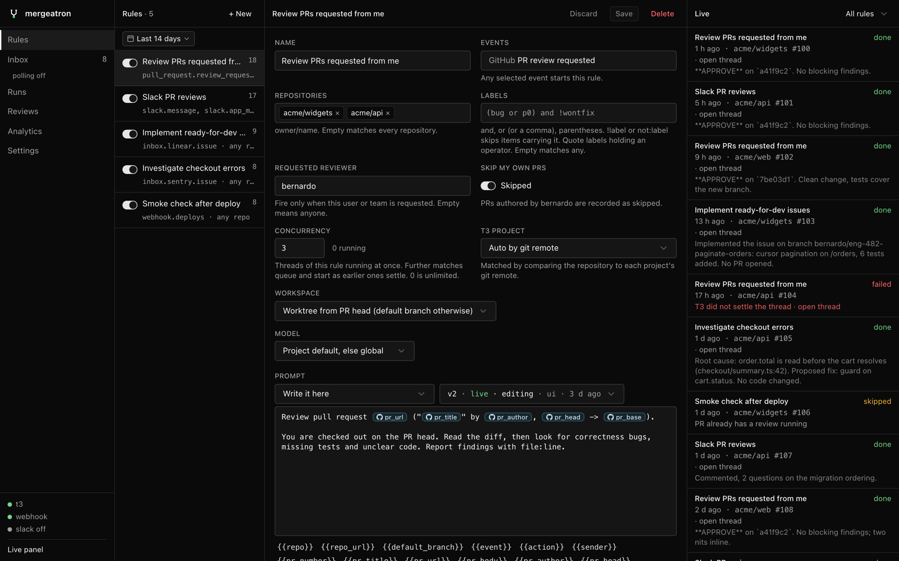
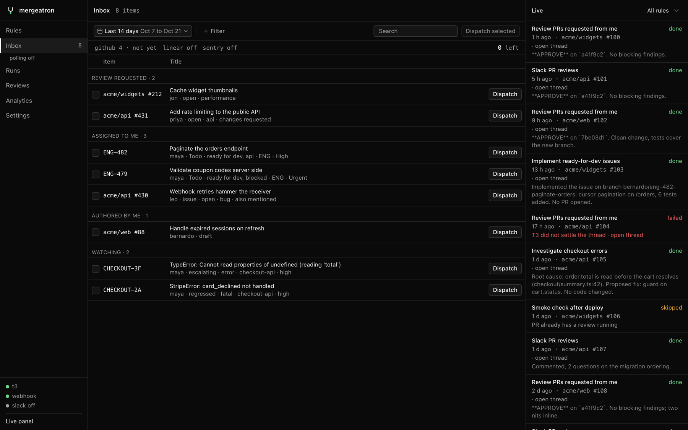
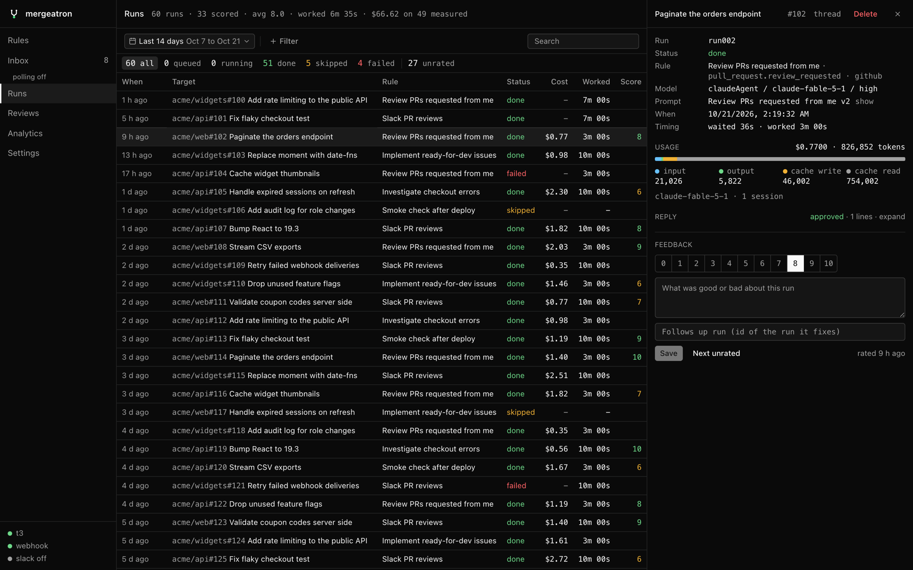

# mergeatron

Start [T3 Code](https://github.com/pingdotgg/t3code) agent threads from GitHub, Slack, Linear, Sentry or any webhook.

When someone requests your review on a PR, drops a PR link in Slack, or an error starts escalating, mergeatron opens a T3 Code thread with a prompt you wrote, on a worktree checked out at the PR head. It watches the thread until it settles, records the result, cost and a score, and for Slack posts the agent's reply back in the thread.



## What it does

- **Rules** turn events into threads: pick events, filters, a project, a model and a prompt. Prompts are versioned, so you can promote, roll back and compare.
- **Inbox** polls the PRs and issues that involve you (GitHub, Linear, Sentry). Dispatch one by hand, or let a rule on the inbox fire automatically.
- **Slack and MCP** let teammates and other agents request reviews and second passes in a thread.
- **Runs and analytics** show what every thread did, what it cost, and how good it was.
- **Stuck PRs** pause after repeated change requests and hand off with a summary instead of looping.



## Quick start

Needs [Bun](https://bun.sh), T3 Code 0.0.46+ and the `gh` CLI.

```sh
bun install
cp .env.example .env
```

1. Issue a token matching your T3 Code version and put it in `.env` as `T3_TOKEN`:

   ```sh
   npx t3@<version> auth session issue --token-only --ttl 365d --label "github review orchestrator"
   ```

2. Put a secret of your choice in `.env` as `GITHUB_WEBHOOK_SECRET`.
3. Start it:

   ```sh
   bun --hot index.ts
   ```

4. Open http://localhost:8787, go to **Settings → Connection** and click **Test thread**.

Then [create a rule](docs/rules.md) and [connect GitHub](docs/webhooks.md#github). To keep it running without a terminal on macOS, `bun service.ts install`.

## Documentation

| | |
| --- | --- |
| [Getting started](docs/getting-started.md) | Install, first review, the UI, environment, running as a service, updating |
| [Rules](docs/rules.md) | Events, filters, prompts and versions, concurrency, stuck PRs |
| [Webhooks](docs/webhooks.md) | GitHub and custom webhooks |
| [Slack and MCP](docs/slack.md) | Slack app, second passes, reactions, MCP tools for agents |
| [Inbox](docs/inbox.md) | Sources, dispatch, automations, filter expressions |
| [Runs and analytics](docs/runs.md) | Scores, usage and cost, related PRs, filters, API |
| [Development](docs/development.md) | Architecture, tests, observability |
| [Upgrading from T3 Review](docs/upgrading.md) | Renamed MCP server, launchd agent, database |



## License

[MIT](LICENSE)
