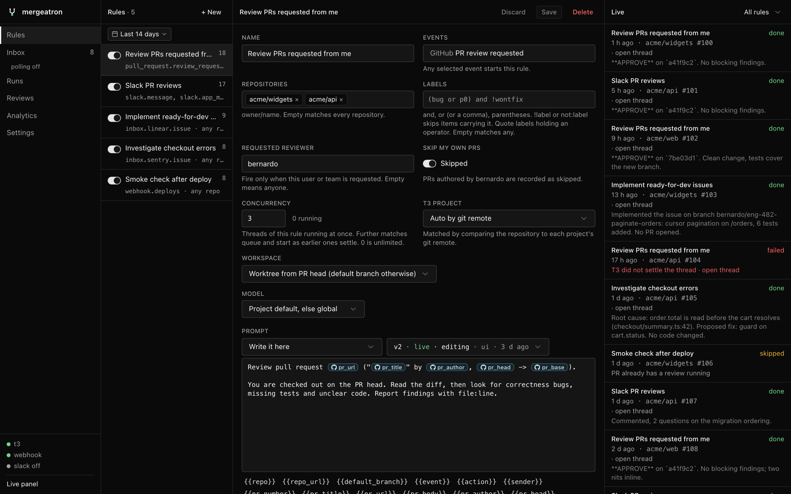

# Getting started

Install, connect to T3 Code, and run your first review.

## Requirements

- [Bun](https://bun.sh)
- [T3 Code](https://github.com/pingdotgg/t3code) 0.0.46 or later, running on the same machine
- The [`gh` CLI](https://cli.github.com), logged in (inbox polling, PR head lookup for Slack)

## Install

```sh
bun install
cp .env.example .env
```

1. Issue a token. Match the version of your installed T3 Code (shown in About):

   ```sh
   npx t3@<version> auth session issue --token-only --ttl 365d --label "github review orchestrator"
   ```

   Put it in `.env` as `T3_TOKEN`.

2. Pick a webhook secret and put it in `.env` as `GITHUB_WEBHOOK_SECRET`.

3. Run:

   ```sh
   bun --hot index.ts
   ```

   The UI is at http://localhost:8787.

## Your first review

1. Open **Settings → Connection** and click **Test thread**. It starts a one-message thread in a T3 project, confirming the token, RPC and provider work before you wire up GitHub.
2. Open **Rules**, click **+ New**, pick the event **GitHub PR review requested**, set your GitHub login as **Requested reviewer** and write a prompt (see [Rules](rules.md)).
3. [Connect GitHub](webhooks.md#github) so it delivers events.
4. Ask for your review on a PR. A run appears in the live log on the right, a T3 thread opens on a worktree at the PR head, and the agent's final message lands on the run when the thread settles.

No webhook yet? Open **Inbox**, find a PR and click **Dispatch** to run a prompt on it by hand ([Inbox](inbox.md#dispatch)).

## The UI



The sidebar holds the pages, live counts (open inbox items, running runs, paused reviews), the inbox's next poll and connection health.

| Page | What it is for |
| --- | --- |
| **Rules** | Your rules, their runs in the range, and the selected rule's editor ([Rules](rules.md)) |
| **Inbox** | PRs and issues that involve you, dispatch and automations ([Inbox](inbox.md)) |
| **Runs** | Every run with cost, score and the agent's reply ([Runs and analytics](runs.md)) |
| **Reviews** | One row per PR: its status (reviewing, queued, paused, changes requested, approved) and review counts |
| **Analytics** | Trends and breakdowns by model, author, trigger and prompt version |
| **Settings** | Connection, defaults, polling, presets, webhooks, Sentry, reviews, Slack and MCP |

The live run log sits on the right of every page but **Runs**; **Live panel** at the bottom of the sidebar hides it.

Every page but Settings opens on a date range and its filters. Both live in the URL and carry across pages ([Date range and filters](runs.md#date-range-and-filters)).

### Settings

One section shown at a time:

- **Connection**: what the service talks to, the **Test thread** button, the update check.
- **Defaults**: model, runtime mode, your GitHub login (lets rules skip PRs you authored), count of delegated tasks in usage.
- **Polling**: which inbox sources are polled and how often.
- **Sentry**: which Sentry issues reach the inbox.
- **Dispatch presets**: prompts you stack when dispatching from the inbox.
- **Webhooks**: [custom webhooks](webhooks.md#custom-webhooks).
- **Reviews**: how many change requests in a row pause a PR's reviews, plus the handoff prompt ([Stuck PRs](rules.md#stuck-prs)).
- **Slack and MCP**: review channel, mentions, your Slack user id and the message templates ([Slack](slack.md)).

Everything autosaves, except presets.

## Environment

Set in `.env` (Bun loads it). Only `T3_TOKEN` is required.

| Variable | Purpose |
| --- | --- |
| `T3_TOKEN` | Bearer token with `orchestration:operate` scope |
| `GITHUB_WEBHOOK_SECRET` | Verifies GitHub signatures. Strongly recommended |
| `SLACK_APP_TOKEN`, `SLACK_BOT_TOKEN` | Both enable [Slack](slack.md) |
| `LINEAR_API_KEY` | Polls Linear in the [inbox](inbox.md#sources) |
| `SENTRY_AUTH_TOKEN`, `SENTRY_ORG`, `SENTRY_URL` | Polls Sentry in the inbox |
| `T3_ORIGIN` | T3 Code's origin. Defaults to the one in `~/.t3/userdata/server-runtime.json` |
| `PORT` | UI and webhooks, default 8787 |
| `MCP_PORT` | [MCP server](slack.md#mcp-server-for-agents), loopback only, default 8788 |
| `DATA_PATH` | SQLite file ([Data](#data)) |
| `OTEL_EXPORTER_OTLP_ENDPOINT` | Exports logs, metrics and traces ([Observability](development.md#observability)) |

## Run as a service (macOS)

Install it as a launchd user agent to keep it running without a terminal. It starts at login and launchd restarts it if it crashes:

```sh
bun service.ts install
```

| Command | Does |
| --- | --- |
| `status` | pid and last exit code |
| `logs` | tails `~/Library/Logs/mergeatron/mergeatron.log`, one timestamped line per decision (grep by `delivery=` or `run=`) |
| `restart` | picks up code or `.env` changes |
| `uninstall` | stops it and removes the agent |

The agent runs `bun index.ts` from this directory, so `.env` is the same one you use by hand. Reinstall after moving the checkout or changing the CA bundle path ([Slack behind a proxy](slack.md#behind-a-tls-inspecting-proxy)).

## Updating

The sidebar shows **update · N** when the tracked upstream (`origin/main` for a plain clone) has commits the running server does not. **Settings → Connection** lists them and flags whether they bring migrations or dependency changes.

**Update and restart** fast-forwards the checkout, runs `bun install` if `bun.lock` moved, then restarts: launchd restarts the agent, `bun --hot` reloads on its own, and a plain `bun index.ts` spawns a replacement before exiting. Migrations apply on that start. A checkout with uncommitted changes cannot be updated from the UI. `GET /api/update` returns the same check.

## Data

The SQLite database lives at `~/.mergeatron/data/mergeatron.sqlite` (override with `DATA_PATH`), outside the checkout. Every checkout shares that default file, so give a second instance its own `DATA_PATH`.
