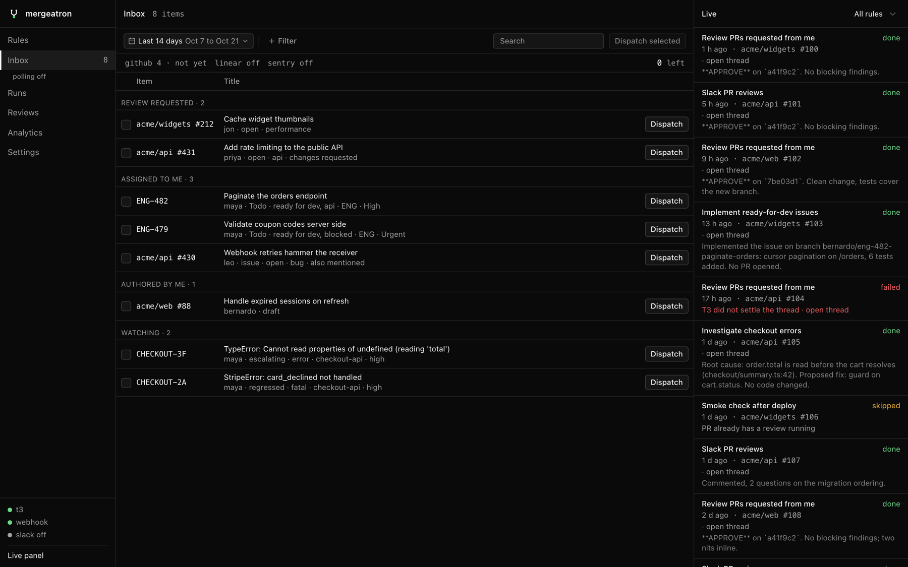

# Inbox

Besides webhooks and Slack, the service polls for the open PRs and issues that involve you. **Inbox** lists the ones updated in the range, grouped by why they are yours. Each row (or a selection) can be dispatched to T3 with a composed prompt, and rules on the inbox events do the same automatically.

## Sources

| Source | Needs | Brings |
| --- | --- | --- |
| **GitHub** | The `gh` CLI, logged in (private repos included) | PRs where your review is requested, PRs and issues assigned to you, PRs and issues that mention you, PRs you authored. One GraphQL search per reason |
| **Linear** | `LINEAR_API_KEY` in `.env` (personal API key) | Issues assigned to or created by you that are not done, plus issues whose description or comments mention you (from your notifications) |
| **Sentry** | `SENTRY_AUTH_TOKEN` and `SENTRY_ORG` in `.env`; `SENTRY_URL` for self-hosted or a region such as `https://de.sentry.io` | Unresolved issues seen in the last 14 days that pass the [filters](#sentry-filters), newest first, up to 100. The token needs `event:read`, `org:read` and `project:read` |

Without a key, Linear and Sentry are off. **Settings → Polling** turns each source on or off and sets its interval in minutes; the counts in the inbox bar poll on click.

Each item carries its `reasons` (`review_requested`, `assigned`, `mentioned`, `authored`, `watching`), labels, state (`open`/`draft`, or the Linear state name and type), Linear team and priority, and for PRs the head branch and commit. A Sentry issue is `watching`, plus `assigned` when it is assigned to the token's user; its label is its level (`error`, `fatal`, ...), its state the substatus (`new`, `escalating`, `regressed`, `ongoing`), its team the Sentry project slug, and `{{issue_body}}` holds the exception, culprit and event counts. The inbox shows the latest run on each item from any trigger.

Items are stored in SQLite, so the inbox is full the moment the service starts and every poll is a diff:

- New items get a first-seen time (the "In inbox" column).
- Items the source stops returning (closed, merged, unassigned, resolved, done) are marked gone and kept for 30 days. An item that comes back starts a new stay.
- The **left** toggle lists only the departed items something ran on (a dispatch or a rule), so a churning source such as Sentry does not bury them.

The same data is at `GET /api/inbox` (`?gone=1` appends departed items). `POST /api/inbox/poll` with `{"source"}` polls now.

### Sentry filters

**Settings → Sentry** decides which Sentry issues reach the inbox at all; an empty filter lets everything through.

- **Projects**: project slugs, usually one per service. Empty covers every project the token can see.
- **Environments**: any of the listed.
- **Tags**: Sentry search terms, typically `key:value` such as `service:checkout`. Values of one key match any of them, different keys must all match: `service:checkout`, `service:billing` and `region:us` search `service:[checkout,billing] region:us`. Any other search term works too (`level:fatal`, `!release:beta`, free text).

The fields suggest the instance's projects, their environments and the top values of tags with few values. The search the next poll sends is shown under the fields, and saving polls Sentry right away, so issues outside the new filters leave the inbox at once.

## Dispatch

**Dispatch** on a row, or **Dispatch selected** for several, opens the composer:

1. Click presets to stack them. The stacked bodies become the message; edit it freely.
2. Pick the T3 project (auto by git remote, or explicit; Linear and Sentry issues have no repository, so pick one), workspace, model and how many threads to run at a time.
3. Dispatch. One thread starts per item.

The message is a template the server renders per item with the same variables webhook deliveries get (`pr_url`, `issue_url`, ...) plus `labels`, `reasons`, `state`, `state_type`, `team`, `priority`, `issue_identifier`, `branch` and `review_decision`.

Presets are edited in **Settings → Dispatch presets** (`/api/prompts`, seeded with "Review PR", "Implement issue" and "Address review feedback"): one row per preset, click to open it, rename it or save its body as a new version ([Prompt versions](rules.md#prompt-versions)).

A dispatch by hand reviews a PR even when its automated reviews are paused; one thread per PR or issue at a time still holds. The run log shows dispatches under the preset names with source `manual`.

## Automations

An automation is a rule on an inbox event: **Inbox: GitHub PR**, **Inbox: GitHub issue**, **Inbox: Linear issue** or **Inbox: Sentry issue**. A rule polls one source: picking an inbox event of one source drops the others'.

On top of the repository list the editor gets:

| Filter | Notes |
| --- | --- |
| **Reasons** | Token field with values seen in the inbox and their counts; type to add one not seen yet |
| **States** | Same. Linear state name or type, Sentry substatus or status, GitHub `open`/`draft` |
| **Teams** | Linear teams or Sentry projects (within what the Sentry filters let in), instead of repositories |
| **Labels** | An expression, see below |
| **Re-run on push** | PR rules. Default on: fires again for each new head commit, like `pull_request.synchronize` |

Label and state filters work on webhook rules too, since PR and issue payloads carry `labels` and `state`.

### Label expressions

`(bug or p0) and !wontfix`

- `and`, `or` (or a comma) and parentheses, with `and` binding tighter.
- `!label` or `not:label` skips items carrying the label, and negates a group too.
- Consecutive words are one label (`Ready For Dev`). Quote a label holding an operator, a parenthesis or a comma (`"Bugs and Fixes"`).
- The label at the caret autocompletes. An expression that does not parse is shown and refused on save.

Labels come from the source itself: after a poll, labels older than an hour are synced from every GitHub repository with inbox items or named in a rule, and from Linear's workspace and team labels. The editor suggests those within the rule's repositories or teams.

### Examples

- Review every PR where my review is requested in `acme/widgets`: **Inbox: GitHub PR**, repo `acme/widgets`, reason `review requested`.
- Implement Linear issues in Todo assigned to me with label ready-for-dev: **Inbox: Linear issue**, team `ENG`, reason `assigned to me`, state `Todo`, label `ready for dev`, with the project set.
- Investigate escalating fatal errors in checkout: **Inbox: Sentry issue**, project `checkout-api`, state `escalating`, label `fatal`, with the project set.

### Previewing and firing

**Matches now** in the editor lists the inbox items for the rule's events, matching ones first with what the rule did for them, the rest with the matcher's reason ("labels needs design include none of ready for dev", "state In Progress is not Todo").

After every poll each armed rule fires on the items it matches. A rule is armed for an item when the item saw activity after the rule was last saved, so a new or re-enabled rule does not fan out over everything already in the inbox. **Run on N now** backfills (`POST /api/rules/:id/run-now`).

An item fires a rule once per delivery id:

- A PR's is its key. With **Re-run on push**, it fires again for each new head commit.
- An issue's is its key until it leaves the rule's filters after the rule ran for it (a label or state change, say). From then on it is `<key>#1`, `#2` and so on, so the rule fires again each time the issue matches it again. Only enabled rules on the issue's event count as left, and the issue must still be in the inbox for a poll to see it leave.
- An issue already busy with a thread is not recorded as skipped: it fires on a later poll once that thread settles.

Runs show in the log with source `poll`.
