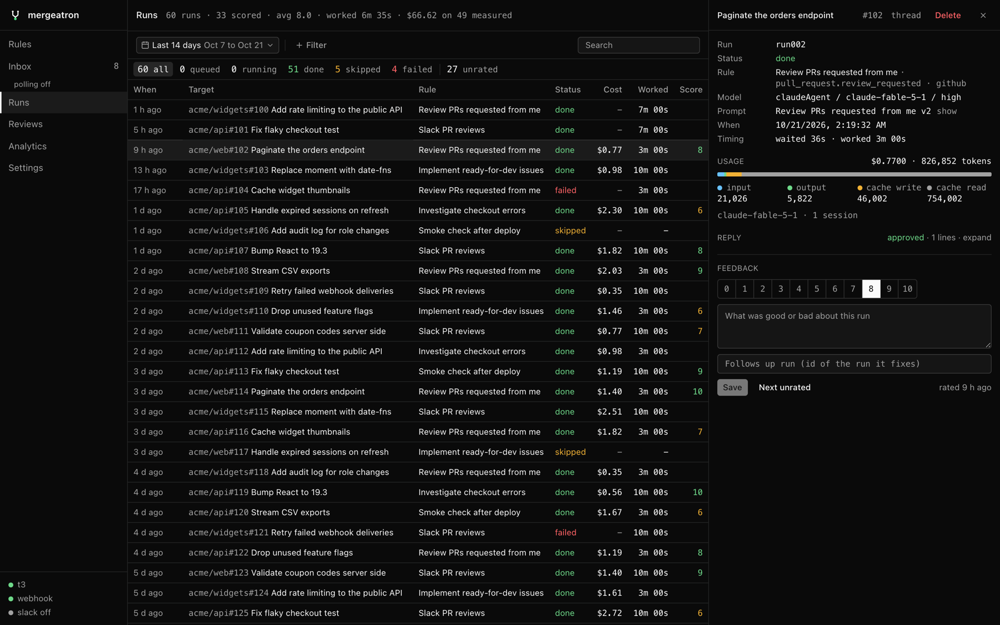
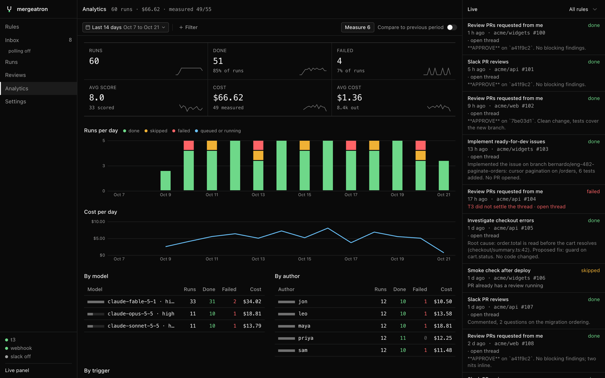

# Runs and analytics

Every match of a rule is a run. **Runs** is the ledger, **Analytics** the trends. Rate runs and compare prompt versions on score and cost together.

## Runs

**Runs** lists every run newest first with its target, rule, model, prompt version, status, cost and tokens, how long its thread worked and its score, within the range and filters ([Date range and filters](#date-range-and-filters)). The counts toggle status and unrated; the search box matches titles, targets and rules.

The page header sums up the listed runs: how many are scored, their average score and average work time, and what the measured ones cost. Filter by one prompt version, then another, to compare them.

Picking a run opens it beside the table:

- Trigger, the [PRs linked to its thread](#related-prs), model, prompt versions (the rendered message on **show**) and timing.
- Usage: cost, tokens split by kind, the models that answered ([Usage and cost](#usage-and-cost)).
- The reply, folded to its verdict and length; click to read it.
- A 0 to 10 score with written feedback. Either one alone saves; rating again replaces it.

**Next unrated** (or ⌘⏎ in the feedback box, which saves first) moves to the next finished run without a rating. Ratings feed the MCP `run_analytics` tool.

API: `GET /api/runs/history` (the scope params below plus `limit`), `GET /api/runs/:id` and `PUT /api/runs/:id/rating` with `{ rating, feedback }`.

### Usage and cost

When a run settles, the service measures what its thread spent with [ccusage](https://github.com/ccusage/ccusage), run through `bun x ccusage@20` (fetched on first use, nothing to install). T3 names the Claude Code session behind each thread; ccusage reads that session's log in `~/.claude/projects`, subagents included. The run stores:

- input, output, cache creation and cache read tokens
- the estimated cost in USD (list prices, not your bill)
- every model that answered

Tasks the thread delegated through T3 run in threads of their own and count too, however deep. Turn off **Count delegated tasks** in **Settings → Defaults** to measure the run's own thread only.

Runs from the last 30 days with no usage yet (older runs, or a failed measurement) are measured at startup, and on demand with `POST /api/runs/usage/backfill` or the MCP `backfill_usage` tool, in the background, one run at a time. Older logs are usually gone, since Claude Code prunes them after 30 days. Threads on other providers record nothing.

Usage shows up in the MCP tools and the API: `list_runs` and `get_run` carry it as `usage` (null until measured), `list_runs` with `sort: "cost"` lists the most expensive measured runs first, and `run_analytics` adds measured counts, total and average cost and average tokens by kind to each prompt version and model.

### Related PRs

A run's related PRs are the ones linked in T3 to its thread, or to the tasks it delegated: the PR a review ran on (linked when the thread starts) and the PRs the agent opened or worked on (agents link them with T3's `link_pull_request`). Each comes with T3's last GitHub sync of its title and state: open, draft, merged or closed.

They are read when the run settles and stored on the run, so they outlive the thread, and read again whenever the run is opened in the UI (`GET /api/runs/:id/pull-requests`) or with the MCP `get_run`, so PRs linked later and merges show up. `list_runs` carries the stored list as `pullRequests`. At startup, settled runs whose PRs were never read are read in the background.

## Analytics

**Analytics** sums up the runs in the range and filters: runs, done, failed, average score, cost and average cost, each with a trend over the days and, with **Compare to previous period** on, the change from the period of the same length before.

Below are runs per day by outcome and cost per day, then runs, done, failed and cost per model, per PR or issue author and per trigger source, and per prompt version (the live one marked): runs, how many are scored and their average score, how many have usage measured, their average and total cost, average output tokens and the share of input read from the prompt cache.

Clicking a row of a breakdown adds it as a filter. The header shows how many settled runs are measured; **Measure** starts the backfill for the rest (`GET /api/runs/usage/backfill` says how many are left and whether one is running).

Sources are `github` (webhook), `slack` (Socket Mode), `poll` (inbox automations), `webhook` (custom webhooks) and `manual` (inbox dispatches and connection tests). The same data is at `GET /api/analytics` (the scope params, plus `utcOffset` in minutes so days split at local midnight).

## Date range and filters

Runs, Reviews, Analytics and the rule counts read one range and one set of filters from the URL, kept when switching pages.

- **Range**: `24h`, `7d`, `14d` (the default), `30d`, `90d`, `month` or `all`, or `from` and `to` days. Pick a preset or a custom range from the calendar.
- **+ Filter** adds a filter by status, rule, source, model, prompt, author or repo. Each takes several values (any of) with their run counts in the range, and shows as a token that reopens or clears it.
- The status filter's **Exclude selected** flips it to "is not" (all runs not skipped).
- The prompt filter's **Live versions only** follows promotions: it means every preset's and rule's live version, whichever that is now.
- Reviews offers rule, repo and author. The inbox has its own source, kind and reason filters and shares repo.

The run endpoints take the same scope as search params:

| Param | Value |
| --- | --- |
| `from`, `to` | ISO timestamps |
| `runStatus`, `rule`, `source`, `model`, `author`, `repo` | Comma-separated |
| `prompt` | `owner:id` for every version, `owner:id:version` for one |
| `live=1` | Live versions only |
| `notRunStatus=1` | Leave the `runStatus` values out |

`GET /api/runs/facets?from&to` lists the values each filter offers with run counts.
